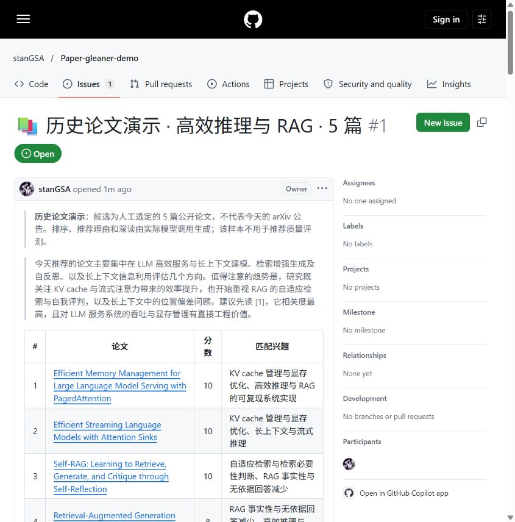
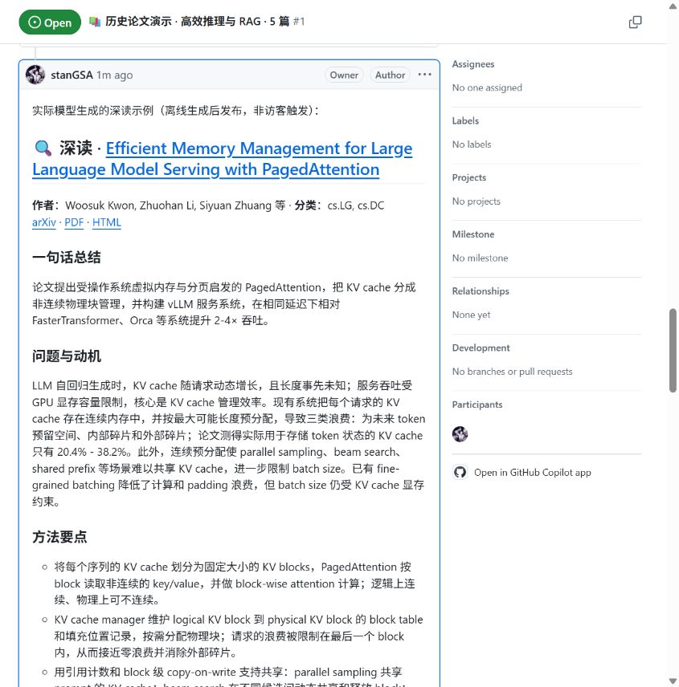
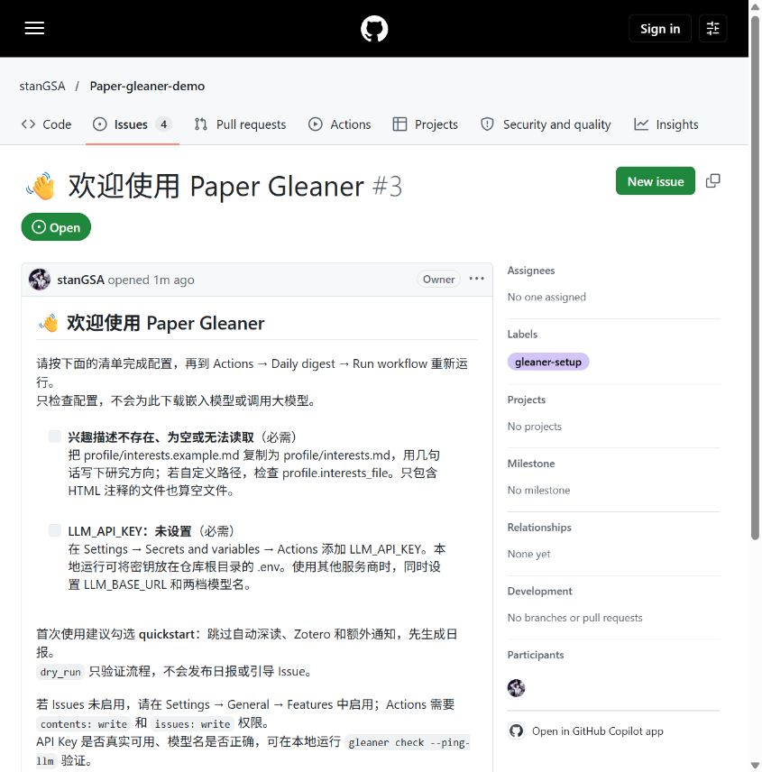

# Paper Gleaner 公开演示

[主项目](https://github.com/stanGSA/Paper-gleaner) · [历史论文日报与深读](https://github.com/stanGSA/Paper-gleaner-demo/issues/1) · [冷启动验收](docs/first-run.md) · [手动 Actions](https://github.com/stanGSA/Paper-gleaner-demo/actions)

本仓库包含主项目 Phase 5 的演示代码快照。兴趣仅来自 [公开演示画像](docs/demo/interests.md)，没有个人研究方向。

## 两类示例

- **历史论文演示**：5 篇公开历史论文人工选取，排序、推荐理由、概览和深读调用实际模型生成；不是当天公告，不用于 precision@10 评测。查看 [Issue #1](https://github.com/stanGSA/Paper-gleaner-demo/issues/1) 和 [生成记录](docs/demo/run.json)。
- **真实首次运行**：手动运行 Daily digest，使用 arXiv 当日公告、空数据分支及冷缓存；本次实际抓取 471 篇、精排 20 篇、推送 5 篇；从触发到全部评论为 2 分 16 秒，见 [日报 #2](https://github.com/stanGSA/Paper-gleaner-demo/issues/2) 和验收记录。首次运行会跳过自动深读、Zotero 和额外通知。

主项目的快速开始步骤见其 README；本仓库关闭了定时触发。仅 OWNER / MEMBER / COLLABORATOR 的评论可触发交互，访客可直接浏览现成结果。

## 复现历史示例

```bash
uv sync
# 在本地 .env 中填写自己的 API Key、base URL 和有效模型名
uv run python scripts/build_demo.py
```

Secrets 不会写入代码、Issue 或数据分支。报告由模型生成，应结合原论文核对。

## 页面截图







配置预检查连续重跑、重复项处理和自动关闭的实际验证见 [引导 Issue #3](https://github.com/stanGSA/Paper-gleaner-demo/issues/3)。
