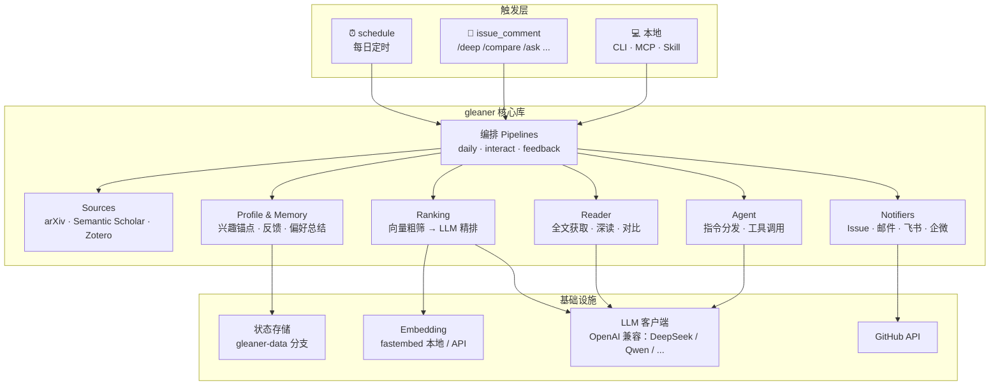
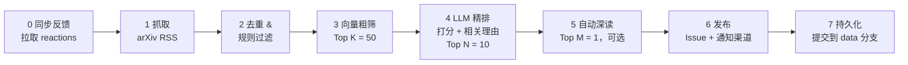
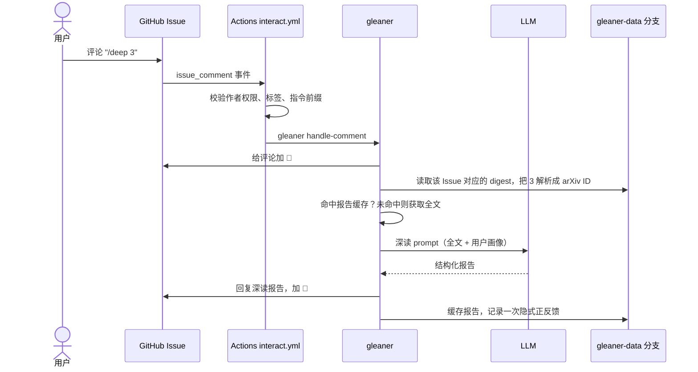

# Paper Gleaner 架构与实施方案

> 状态：草案 v0.1（2026-10-24）
>
> 本文是项目的总体设计，描述「做什么、怎么分层、按什么顺序落地」。具体实现细节在各阶段开发时再细化。

**一句话定位**：一个 fork 即用、不需要服务器的「论文追踪 Agent」。它每天从 arXiv 挑出和你研究方向相关的新论文，逐篇说明「为什么和你相关」；你可以在 GitHub Issue 里用 `/deep`、`/compare` 追问，它也会根据你的 👍/👎 不断调整推荐。

---

## 目录

1. [背景与目标](#1-背景与目标)
2. [总体架构](#2-总体架构)
3. [核心流程](#3-核心流程)
4. [存储设计](#4-存储设计)
5. [代码结构](#5-代码结构)
6. [技术选型](#6-技术选型)
7. [配置与密钥](#7-配置与密钥)
8. [GitHub Actions 设计](#8-github-actions-设计)
9. [推送渠道](#9-推送渠道)
10. [Claude Code Skill / MCP](#10-claude-code-skill--mcp)
11. [安全与稳健性](#11-安全与稳健性)
12. [成本估算](#12-成本估算)
13. [实施路线图](#13-实施路线图)
14. [用户上手流程](#14-用户上手流程)
15. [开放问题](#15-开放问题)
16. [附录：日报评论示例](#附录日报评论示例)

---

## 1. 背景与目标

### 1.1 现有方案的短板

以 zotero-arxiv-daily 为代表的现有方案，本质上是推荐算法而不是 Agent：它用嵌入向量计算新论文和 Zotero 文献库的加权相似度，再让 LLM 生成一句话摘要。它的局限有三点：

- 兴趣来源必须是 Zotero 文献库；
- 不会深度阅读论文；
- 不能交互，也不会根据反馈学习你的兴趣。

### 1.2 差异化

| 能力 | 现有方案 | Paper Gleaner |
| --- | --- | --- |
| 兴趣来源 | 必须用 Zotero | 写一段研究方向描述即可，Zotero 可选 |
| 筛选方式 | 嵌入相似度 | 嵌入粗筛 + LLM 精排，并说明「为什么和你相关」 |
| 深度阅读 | 无 | Agent 读全文，提取方法、实验、代码链接，对比相关工作 |
| 交互 | 无 | 在 GitHub Issue 里评论 `/deep`、`/compare` 触发 Agent 回复 |
| 记忆 | 无 | 根据 👍/👎 自动更新兴趣画像，存成仓库文件 |
| 生态 | 仅邮件 | 邮件、飞书、企业微信推送，外加 Skill/MCP，在 Claude Code 里也能问 |
| 成本 | — | 适配 DeepSeek、Qwen 等便宜的国产模型 |

**核心设计：用 GitHub Issues 做交互界面。** 每天的推送自动发成一个 Issue，用户在下面评论就会触发 Action 运行 Agent 并回复。整个过程不需要服务器，任何人都能零成本使用。

### 1.3 设计目标

| # | 目标 | 验收标准 |
| --- | --- | --- |
| G1 | fork 即用 | fork 后配置 1 个 Secret、写一段兴趣描述、启用 Actions，10 分钟内收到第一份日报 |
| G2 | 零服务器、低成本 | 全部运行在 GitHub Actions 上；默认使用国产低价模型，每天 LLM 费用在 ¥0.5 以内 |
| G3 | 推荐可解释 | 每篇推荐都写明匹配了用户的哪一个兴趣点、为什么 |
| G4 | 可交互 | 评论指令后 3 分钟内收到回复（主要耗时在 Actions 冷启动） |
| G5 | 会学习、可审计 | 反馈和学到的偏好都以文件形式存在 git 中，可以查看、手改、回滚 |
| G6 | 多端触达 | 邮件、飞书、企业微信推送；在 Claude Code 中通过 Skill/MCP 使用 |

### 1.4 非目标（v1）

- 不做 Web UI，不维护任何服务器；
- 不覆盖全部论文来源：v1 只做 arXiv，但预留 Source 接口；
- 不做多用户：一个 fork 对应一个用户；
- 不替代文献管理工具：Zotero 只作为可选的兴趣输入。

---

## 2. 总体架构

### 2.1 分层



### 2.2 架构原则

1. **一套核心库，多个入口。** 所有能力都实现在 `gleaner` Python 包里，通过一个 CLI 暴露。GitHub Actions、MCP Server、Claude Code Skill 都只是调用这个 CLI 或核心库的不同入口，保证三端行为一致。
2. **流水线优先，Agent 兜底。** 高频、格式固定的任务（日报、`/deep`、`/compare`）用确定性的流水线实现，输出稳定、成本可控；只有开放式问题（`/ask`）才交给带工具调用的 Agent 循环。
3. **仓库即数据库。** 用户画像、反馈、历史、深读缓存都以文本文件存放在 git 中，不依赖任何外部数据库。
4. **LLM 供应商无关。** 只依赖 OpenAI 兼容接口，改 `base_url` 和模型名就能切换 DeepSeek、Qwen、Kimi、GLM、OpenAI 等。
5. **优雅降级。** 任何外部依赖（LLM、Semantic Scholar、某个推送渠道）失败时，主流程照常完成，并在输出中注明降级。

---

## 3. 核心流程

### 3.1 每日推送流水线



| 步骤 | 说明 |
| --- | --- |
| 0. 同步反馈 | 扫描最近 7 天日报 Issue 中每篇论文评论的 reactions，增量写入反馈记录（原因见 [3.4](#34-反馈与记忆)）。只统计仓库所有者的 👍/👎；失败时日报照常运行，只给出警告 |
| 1. 抓取 | 用 arXiv RSS 获取所关注分类当天公告的论文（区分 new / cross / replace / replace-cross）。RSS 条目已包含标题、摘要、作者和分类，无需再调用 API。没有新公告（周末、节假日）时直接结束，不发 Issue |
| 2. 去重与规则过滤 | 排除已处理过的 ID；默认排除 replace 版本；支持关键词白名单（必推）和黑名单（必不推） |
| 3. 向量粗筛 | 计算每篇论文与「兴趣锚点」的综合相似度，保留 Top K（默认 50），详见 3.1.1 |
| 4. LLM 精排 | LLM 分批打分并生成相关理由，保留分数不低于阈值的 Top N（默认 10），详见 3.1.2 |
| 5. 自动深读 | 对分数最高的 M 篇（默认 1，可设为 0）预先生成深读报告，附在对应评论里（实现见 [13.3](#133-phase-4-实现说明)） |
| 6. 发布 | 创建当日 Issue：正文是总览，每篇论文单独一条评论（方便逐篇点 👍/👎）；然后向已启用的渠道发送摘要和 Issue 链接 |
| 7. 持久化 | 写入当日 digest（全部 Top K 候选、分数、理由、Issue 与评论 ID 的映射）、已处理 ID、运行统计，提交到 `gleaner-data` 分支 |

#### 3.1.1 兴趣锚点与粗筛打分

粗筛的对比对象是一组「兴趣锚点」向量，来源有四类：

| 锚点 | 来源 | 说明 |
| --- | --- | --- |
| A1 兴趣描述 | `profile/interests.md`（用户手写） | 首次运行时由 LLM 拆解成若干子方向，每个子方向生成一段英文检索描述。结果按源文件 hash 缓存，描述改动后自动重建。这一步同时解决了「中文描述 vs 英文论文」的跨语言匹配问题 |
| A2 正反馈论文 | 👍、`/like`、`/deep` 过的论文 | 用标题 + 摘要生成向量 |
| A3 负反馈论文 | 👎、`/dislike` 过的论文，`/mute` 的主题 | 作为惩罚项 |
| A4 Zotero 文献库 | 可选 | 兼容 zotero-arxiv-daily 的用法。用标题 + 摘要生成向量，文库内容只缓存在 Actions 缓存里（见 13.3） |

综合分数（权重在配置中可调）：

```text
score(p) = w_interest · max_i cos(p, A1_i)
         + w_pos      · mean_top3 cos(p, A2)      # 按时间衰减加权，半衰期默认 90 天
         + w_zotero   · mean_top3 cos(p, A4)
         − w_neg      · max_j cos(p, A3_j)
```

冷启动时只有 A1；反馈越多，A2/A3 的影响越大。

具体定义（Phase 3 接入反馈锚点，Phase 4 接入 Zotero）：

```text
score(p) = w_interest · max_i cos(p, A1_i)
         + w_pos      · mean_top3_j (d_j · cos(p, A2_j))
         + w_zotero   · mean_top3_l cos(p, A4_l)
         − w_neg      · max_k (d_k · cos(p, A3_k))

d = 信号强度 × 0.5^(距最近一次有效反馈的天数 / feedback_half_life_days)
信号强度 = min(|有效反馈| / 2, 1)：一次 /like 或 /dislike 为 1，一个 👍/👎 为 0.5，只有 /deep 为 0.25
```

- **mean_top3**：先把每个正反馈锚点的相似度乘上它的权重 d，取最大的 3 个求平均，不足 3 个按 0 计。一两次反馈只有部分影响，同一方向的反馈越多、越新，影响越大，不会因为点了一个 👍 就让推荐跑偏；
- **A3** 包括兴趣描述中明确不感兴趣的方向（权重 1）、`/mute` 的屏蔽主题（用英文检索描述生成向量，权重 1，不衰减）和负反馈论文（权重同上），取加权后最接近的一个；
- 每类反馈锚点最多取权重最高的 200 篇；只有 arXiv ID、没有标题和摘要的反馈（arXiv API 不可用时记下的）不参与；
- **A4**：从 Zotero 文库中选出的文献（最多 `profile.zotero.max_items` 篇，默认 200，选取规则见 13.3），用标题 + 摘要生成向量，和 A2 一样放在嵌入列表的最后。不做时间衰减，同样取最相似的 3 个求平均、不足 3 个按 0 计；
- 没有任何反馈、屏蔽主题和 Zotero 锚点时，分数与只用 A1 时完全相同（未启用 Zotero 时逐位相同，有测试用旧实现在随机向量上对比）；
- 每篇候选都记录分项（`interest_score`、`positive_score`、`zotero_score`、`negative_score`，均已乘过权重），`gleaner daily --dry-run` 会打印出来，用来观察反馈和 Zotero 是否生效。

#### 3.1.2 LLM 精排

- **输入**：用户画像（`interests.md` + 学到的偏好 `learned_preferences.md` + 屏蔽的主题）+ 一批论文（每批 10 篇，包含标题、摘要、分类）。学到的偏好和屏蔽主题都可能被用户手改，按不可信数据包裹；两者都没有时 prompt 与只用兴趣描述时完全相同。
- **输出**：结构化 JSON，用 pydantic 校验：

```json
{
  "results": [
    {
      "id": "2410.12345",
      "score": 8,
      "matched_interests": ["长上下文推理"],
      "reason": "提出了 KV cache 分层压缩方法，与你关注的长上下文推理效率直接相关，并在 128K 长度上做了评测。",
      "tldr": "一句话中文摘要",
      "tags": ["efficiency", "long-context"]
    }
  ]
}
```

- **约束**：`score` 采用 0–10 分并给出明确的打分标准；`reason` 必须引用一个具体兴趣点，不允许写成泛泛的「与你的研究相关」。
- **容错**：JSON 解析失败时重试一次；仍然失败就退回按向量分数排序，日报照常发出，并在正文中注明。

### 3.2 交互流程（Issue 评论）



**指令集**

| 指令 | 示例 | 行为 | 实现方式 |
| --- | --- | --- | --- |
| `/deep <ref>` | `/deep 3`、`/deep 2410.12345` | 深读全文，输出结构化报告 | 固定流水线 |
| `/compare <ref> <ref> ...` | `/compare 3 5` | 多篇论文横向对比（问题、方法、实验设置、结果、代码） | 固定流水线 |
| `/compare <ref>` | `/compare 3` | 单篇论文与其相关工作对比（来自 Semantic Scholar 和你的历史） | 固定流水线 |
| `/ask <问题>` | `/ask 今天哪篇的方法能用到我的检索增强实验里？` | 自由问答 | 工具调用 Agent |
| `/more [n]` | `/more 5` | 展开当天未入选的候选（直接读精排结果，不再调用 LLM） | 读缓存 |
| `/like <ref> [原因]` | `/like 3 有开源代码，方法简单` | 显式正反馈，带原因的反馈价值最高 | 写反馈 |
| `/dislike <ref> [原因]` | `/dislike 7 纯 benchmark` | 显式负反馈 | 写反馈 |
| `/mute <主题>` | `/mute 医学影像` | 屏蔽某个主题，作为负向锚点；不带参数时列出已屏蔽的主题 | 写画像 |
| `/unmute <主题>` | `/unmute 医学影像` | 取消屏蔽 | 写画像 |
| `/help` | | 列出指令 | — |

`<ref>` 可以是当天 Issue 中的序号、arXiv ID 或 arXiv 链接。序号按「当前 Issue 对应的那一天」解析，所以在旧日报下评论同样有效。日报推荐的论文编号 1…N，`/more` 列出的候选接着编号 N+1…，同样可以用序号引用。

> 实现状态：Phase 2 实现了 `/deep`、`/compare`、`/more`、`/help`；Phase 3 实现了 `/like`、`/dislike`、`/mute`、`/unmute`；Phase 4 实现了 `/ask`（实现说明见 [13.3](#133-phase-4-实现说明)）。

**为什么 `/deep`、`/compare` 用流水线而 `/ask` 用 Agent**：前两者使用频率高、需要稳定的报告格式和可预期的成本，用固定步骤实现最合适；`/ask` 的问题是开放的，需要模型自己决定查什么，因此使用工具调用循环，最多 8 步并设置 token 上限。

**`/ask` 的循环**（Phase 4）：不用服务商的原生 tool calling，而是一个 JSON 协议——每一步让 deep 档模型输出 `{"action": "call_tool", "tool": ..., "arguments": {...}}` 或 `{"action": "answer"}`，pydantic 校验（工具名只能从已注册的工具中选），工具结果按不可信数据包裹后交给模型；模型决定作答后，再用一次普通对话输出 Markdown 回答。到达步数、token 或时间上限时同样让模型基于已有信息作答，并在回复中注明。上下文只有当前 Issue 中所有者、成员、协作者和机器人自己的评论。

**Agent 工具（全部只读）**

| 工具 | 作用 |
| --- | --- |
| `get_digest(date)` | 获取某天的日报与候选 |
| `get_paper(ref)` | 获取论文元数据 |
| `read_fulltext(arxiv_id, sections?)` | 获取全文或指定章节 |
| `search_arxiv(query)` | 检索 arXiv |
| `related_works(arxiv_id)` | 通过 Semantic Scholar 获取引用、被引和推荐论文 |
| `get_profile()` | 读取兴趣描述与学到的偏好 |
| `search_history(query)` | 在推送过、点赞过的历史论文中检索 |

Agent 没有任何写操作工具。发回复、写反馈这类副作用都由编排代码完成，不由 LLM 决定，从而限制提示注入的影响范围（见 [11](#11-安全与稳健性)）。这些工具实现在 `gleaner/agent/tools.py`，`/ask` 和 MCP Server 共用；参数都经过校验（日期、arXiv ID、查询长度），结果截断到约 4000 token。

### 3.3 深读

**全文获取（按优先级）**

1. arXiv HTML 版（`arxiv.org/html/<id>`）：结构清晰，保留章节；
2. PDF：用 PyMuPDF 抽取文本；
3. 都失败时退化为基于摘要的分析，并在回复中注明。

**处理步骤**

1. 切分章节，按优先级保留：Abstract、Introduction、Method、Experiments、Conclusion 优先；References 和大部分 Appendix 跳过；
2. 截断到 token 预算（默认约 30k）。v1 单次调用；遇到超长论文再考虑按章节 map-reduce；
3. 代码链接：从正文正则提取 GitHub、GitLab、Hugging Face 链接，并查询 Hugging Face Papers 上关联的代码仓库（Phase 2 暂未接入，见 13.1）；
4. 相关工作：通过 Semantic Scholar API 获取参考文献和推荐论文，再与用户历史（推送过、点赞过的论文）做向量近邻检索（与历史的近邻检索还没有做，见 13.2）。

**报告模板**

- 一句话总结
- 解决什么问题、动机是什么
- 方法要点
- 实验：数据集、基线、关键结果（表格）、消融
- 代码与资源
- 与你研究的关系（结合用户画像）
- 局限与值得追问的点
- 相关工作对比（表格）：Phase 2 中由 `/compare <ref>` 单独生成，`/deep` 报告不含这一节

**缓存**：报告保存在 data 分支的 `reports/<arxiv_id>.md`，重复执行 `/deep` 直接返回缓存；`/deep 3 --force` 强制重新生成。

### 3.4 反馈与记忆

**反馈信号**

| 信号 | 来源 | 权重 |
| --- | --- | --- |
| 👍 / 👎 reaction | 论文评论上的表情，下一次日报前同步 | ±1 |
| `/like`、`/dislike`（可带原因） | 即时写入 | ±2 |
| `/deep`、`/compare` | 隐式正反馈 | +0.5 |
| `/mute <主题>` | 即时写入 | 负向锚点 |
| 没有任何反应 | — | 0，不作为负例 |

> **注意：GitHub 的 reaction 不会触发 Actions 事件。** 因此 reaction 采用「拉取」方式：每日任务开始时扫描最近 7 天的日报评论，读取 reactions 并增量写入。显式指令（`/like` 等）则会立即生效。

**聚合规则**（Phase 3 实现）：同一篇论文可能有很多条反馈记录，读取时先按 `created_at` 排序（union 合并后行序不可靠），再合成一个「有效反馈」：

| 分项 | 规则 | 取值 |
| --- | --- | --- |
| 表情 | 只看这篇论文最新的一条表情记录 | +1、−1 或 0（撤销） |
| 显式反馈 | `/like`、`/dislike` 以最新一条为准 | +2 或 −2 |
| 隐式反馈 | 有过 `/deep` 或 `/compare` 就算，做多少次都只算一次 | +0.5 |

三者相加：为正进入 A2，为负进入 A3，为 0 不参与。例如 👍 后又 `/dislike` 为 −1（负反馈），`/deep` 了三次再点 👎 为 −0.5。

**表情同步**：只统计仓库所有者（`GITHUB_REPOSITORY_OWNER`，不区分大小写）的 👍/👎。一篇论文的状态是「有 👍 为 +1、有 👎 为 −1、两个都点了为 0」，同一篇论文出现在多份日报里时合并计算。每次同步把状态与该论文最新一条表情记录比较，只追加有变化的：新的状态写成 `weight` 为 +1 / −1 的记录，撤销写成 `weight=0` 的记录（`signal` 为被撤销的那个表情）。同一个表情每天都会读到，但不会重复写入，聚合时也只取最新状态，不会重复计数。超过 7 天的日报不再同步，之后的撤销不会被看到。

**两层记忆**

1. **向量层（自动、快速）**：反馈论文的向量直接作为正/负锚点参与粗筛打分（见 3.1.1），每天生效。
2. **语义层（较慢、人可读）**：每周一次，或新增反馈达到 N 条时，由 LLM 把反馈记录及其原因总结成 `learned_preferences.md`，例如「偏好有开源代码的工作」「对纯 benchmark 论文兴趣低」。这份文件会注入精排 prompt。总结时把当前文件一并作为输入，要求增量修改，而不是每次重写。（Phase 3 只做了每周一次，文件格式见 13.2。）

**边界**：用户手写的 `interests.md` 优先级最高，LLM 永远不改动它，只写 `learned_preferences.md`。用户可以直接编辑或删除其中的条目；由于所有记忆都在 git 中，「撤销一次学习」就是一次 `git revert`。

---

## 4. 存储设计

状态分两处存放：

| 位置 | 内容 | 谁来写 |
| --- | --- | --- |
| `main` 分支 | 代码、`config.yaml`、`profile/interests.md` | 用户 |
| `gleaner-data` 孤儿分支 | 反馈、历史、缓存、学到的偏好 | Actions 机器人 |

机器写入的状态单独放在一个孤儿分支上，好处有两点：`main` 的提交历史不会被每天的自动提交淹没；用户 fork 后从上游同步代码时也不会产生冲突。

同理，上游仓库只提供 `config.example.yaml` 和 `profile/interests.example.md`，不包含 `config.yaml` 和 `profile/interests.md`。用户在自己的 fork 中创建这两个文件，以后同步上游时不会冲突。

**`gleaner-data` 分支布局**

```text
gleaner-data/
├── .gitattributes                # *.jsonl merge=union，并发追加时自动合并
├── profile/
│   ├── anchors.json              # 兴趣描述拆解出的子方向和英文检索描述（含源文件 hash）
│   ├── learned_preferences.md    # LLM 总结的偏好（用户可编辑）
│   └── muted.jsonl               # /mute、/unmute 事件，只追加，回放得到当前的屏蔽列表
├── feedback/
│   └── 2026-10.jsonl             # 按月分片，只追加
├── history/
│   ├── seen/
│   │   └── 2026-10.jsonl         # 已处理的 arXiv ID，按月分片，去重时读取最近 3 个月
│   └── digests/
│       └── 2026-10-24.json       # 当日推送的论文和其余候选（含分数、理由）、Issue 与评论 ID
├── reports/
│   └── 2410.12345.md             # 深读报告缓存
└── stats/
    └── 2026-10.jsonl             # 每次运行的 token 用量、耗时、数量
```

- **向量不入库**：模型权重和近期论文向量用 `actions/cache` 缓存，丢失后可以重算。反馈记录本身保存标题和摘要，反馈论文的向量（通常只有几百条）每次重算的成本可以忽略。
- **并发写入**：推送被拒时先 rebase 远端再重试。`.jsonl` 文件配置 `merge=union`，两个任务同时追加同一文件时会自动合并，不会产生冲突。反馈和屏蔽主题都是只追加的 jsonl；唯一会被整体改写的 `learned_preferences.md` 只由 weekly 写入，rebase 冲突（例如这期间用户在 gleaner-data 上手改了它）时放弃本次写入并报错，不会覆盖用户的修改。

**核心数据模型（示意）**

```python
class Paper(BaseModel):
    id: str  # arXiv ID，如 "2410.12345"
    title: str
    abstract: str
    authors: list[str]
    categories: list[str]
    announce_type: str | None  # new / cross / replace / replace-cross
    announced: datetime | None  # 公告时间
    # url、pdf_url 由 id 推导，不单独存储


class ScoredPaper(Paper):
    coarse_score: float | None
    coarse_match: str | None  # 向量最接近的兴趣子方向
    interest_score: float | None  # 粗筛分项：兴趣、正反馈、负向（Phase 3）、Zotero（Phase 4）
    positive_score: float | None
    negative_score: float | None
    zotero_score: float | None
    forced: bool  # 命中 include_keywords，跳过了粗筛
    llm_score: int | None  # None 表示精排失败或未精排
    matched_interests: list[str]
    reason: str
    tldr: str
    tags: list[str]


class Feedback(BaseModel):
    paper_id: str
    title: str
    abstract: str
    signal: Literal["up", "down", "like", "dislike", "deep", "compare"]
    weight: float  # 表情记录为同步时的状态：+1、−1、0（撤销）
    note: str | None  # /like 或 /dislike 附带的原因
    source: Literal["reaction", "command"]
    created_at: datetime
```

---

## 5. 代码结构

```text
paper-gleaner/
├── .github/workflows/
│   ├── daily.yml                 # 定时：每日推送
│   ├── interact.yml              # issue_comment：指令交互
│   ├── weekly.yml                # 定时：偏好总结（可选周报）
│   └── ci.yml                    # lint + test
├── .claude/skills/paper-gleaner/
│   └── SKILL.md                  # Claude Code Skill
├── gleaner/
│   ├── cli.py                    # typer CLI：check / daily / handle-comment / digest / deep / compare / ask / feedback / summarize-preferences / ...
│   ├── config.py                 # 读取 config.yaml 与环境变量，pydantic 校验
│   ├── redaction.py              # 密钥脱敏（Webhook 地址、SMTP 密码等不进日志和错误信息）
│   ├── models.py                 # Paper / ScoredPaper / Digest / Feedback / DeepReport
│   ├── filters.py                # 去重与关键词过滤
│   ├── mcp_server.py             # MCP Server（stdio，命令 gleaner-mcp）
│   ├── pipelines/
│   │   ├── daily.py
│   │   ├── interact.py
│   │   └── feedback.py           # 日报第 0 步：同步表情
│   ├── sources/
│   │   ├── base.py               # Source 协议，方便以后接入 OpenReview 等
│   │   ├── arxiv.py
│   │   ├── semantic_scholar.py
│   │   └── zotero.py             # Zotero Web API v3：读取文库、缓存、去重和选取锚点
│   ├── profile/
│   │   ├── anchors.py            # 兴趣描述 → 子方向 / 检索描述
│   │   ├── memory.py             # 反馈读写与聚合、偏好总结
│   │   └── muted.py              # 屏蔽主题（/mute、/unmute）
│   ├── ranking/
│   │   ├── embedder.py           # fastembed 本地 / OpenAI 兼容 embeddings API
│   │   ├── coarse.py             # 向量粗筛
│   │   ├── rerank.py             # LLM 精排 + 理由
│   │   └── overview.py           # 日报概览
│   ├── reader/
│   │   ├── fulltext.py           # arXiv HTML / PDF 获取与解析、章节切分、代码链接
│   │   ├── prompt.py             # 深读、对比共用的 prompt 片段（不可信内容的包裹）
│   │   ├── deep_read.py
│   │   └── compare.py
│   ├── agent/
│   │   ├── commands.py           # 指令解析与分发
│   │   ├── tools.py              # Agent 工具（只读）
│   │   └── loop.py               # /ask 的工具调用循环
│   ├── llm/
│   │   ├── client.py             # OpenAI 兼容客户端、重试、token 统计与预算
│   │   └── prompt.py             # token 估算、不可信内容的包裹（各处 prompt 共用）
│   ├── notify/
│   │   ├── base.py               # Notifier 接口、公用的文本工具
│   │   ├── dispatch.py           # 创建已启用的渠道、逐个发送并记录结果
│   │   ├── github_issue.py
│   │   ├── email.py
│   │   ├── feishu.py
│   │   └── wecom.py
│   ├── store/
│   │   └── data_branch.py        # 以 git worktree 检出、提交、推送 gleaner-data 分支
│   └── render/
│       ├── markdown.py           # 日报的 Markdown 渲染、转义、超长评论拆分
│       └── replies.py            # 指令回复（深读 / 对比 / 更多候选 / 帮助）的渲染
├── profile/
│   └── interests.example.md
├── config.example.yaml
├── tests/
├── docs/
│   └── architecture.md           # 本文
└── pyproject.toml
```

---

## 6. 技术选型

| 领域 | 选择 | 理由 |
| --- | --- | --- |
| 语言 | Python 3.11+ | 论文处理与 LLM 生态最完善 |
| 依赖管理 | uv | 在 Actions 中安装快，锁文件可复现 |
| arXiv 抓取 | arXiv RSS（httpx + feedparser）；按 ID 查询时用 arXiv API | RSS 给出当天公告列表和元数据；`/deep <arXiv ID>` 等按 ID 查询时调用 API，遵守请求间隔 3 秒的要求 |
| 嵌入 | fastembed（ONNX）为默认，可切换到 OpenAI 兼容 embeddings API | 不依赖 PyTorch，安装体积小，CPU 推理足够快 |
| 默认嵌入模型 | `BAAI/bge-small-en-v1.5` | 兴趣锚点已由 LLM 转成英文，英文小模型即可；多语言模型作为可选项 |
| LLM | `openai` SDK + 自定义 `base_url` | 一套代码适配 DeepSeek、Qwen、Kimi、GLM、OpenAI 等 |
| 结构化输出 | pydantic + JSON mode | 校验与重试 |
| PDF / HTML 解析 | PyMuPDF / selectolax | 速度快、依赖少 |
| GitHub 交互 | httpx 直接调用 REST API | 只用到少数几个接口，不需要额外依赖，测试时用 respx 模拟 |
| CLI | typer | |
| Markdown 渲染 | Python 字符串拼接 | 版式简单，集中在 `render/markdown.py`，统一做转义 |
| MCP | 官方 `mcp` Python SDK | |
| 测试 | pytest + respx | 用录制的响应 mock HTTP，LLM 调用全部打桩 |

**模型分级**：便宜的模型做量大的活，强一些的模型做需要深度理解的活。

| 档位 | 用途 | 示例（以服务商当前模型名为准） |
| --- | --- | --- |
| `fast` | 兴趣拆解、精排、偏好总结 | `deepseek-chat`、`qwen-plus` |
| `deep` | 深读、对比、`/ask` | `deepseek-reasoner`、`qwen-max` |

---

## 7. 配置与密钥

**`config.example.yaml`（示意）**

```yaml
language: zh                       # 输出语言
timezone: Asia/Shanghai

sources:
  arxiv:
    categories: [cs.CL, cs.LG, cs.AI]
    include_cross_list: true
    include_replace: false

profile:
  interests_file: profile/interests.md
  zotero:
    enabled: false                 # 启用时需要 ZOTERO_ID / ZOTERO_KEY
    library_type: user             # user | group
    collections: []                # 名称或 key；为空时使用整个文库
    include_subcollections: true
    max_items: 200

filters:
  include_keywords: []             # 命中即进入精排
  exclude_keywords: []             # 命中即排除

ranking:
  coarse_top_k: 50
  final_top_n: 10
  min_score: 6                     # LLM 分数低于此值不推送
  weights: {interest: 1.0, positive: 0.6, zotero: 0.5, negative: 0.8}
  feedback_half_life_days: 90
  embedding:
    provider: local                # local | api
    model: BAAI/bge-small-en-v1.5

deep_read:
  auto_top_m: 1                    # 日报中自动深读的篇数，0 表示关闭
  max_input_tokens: 30000
  timeout_seconds: 180             # 深读、对比、/ask 单次 LLM 调用的超时

ask:
  max_steps: 8                     # /ask 最多调用几步工具
  max_tokens: 60000                # 单条 /ask 的 token 上限

llm:
  base_url: https://api.deepseek.com
  models:
    fast: deepseek-chat
    deep: deepseek-reasoner
  daily_token_budget: 500000       # 超出后自动降级

notify:
  github_issue:
    enabled: true
    per_paper_comment: true        # 每篇论文一条评论，便于逐篇反馈
    close_after_days: 7            # 关闭旧日报（关闭后仍可评论交互）
  email:  {enabled: false, subject_prefix: "📚 Paper Gleaner"}
  feishu: {enabled: false, max_papers: 10}
  wecom:  {enabled: false, max_papers: 5}
```

**GitHub Secrets**

| Secret | 是否必需 | 说明 |
| --- | --- | --- |
| `LLM_API_KEY` | ✅ | LLM 服务的 API Key |
| `LLM_BASE_URL` | 可选 | 覆盖配置文件中的 `base_url` |
| `EMBEDDING_API_KEY` | 嵌入使用 API 时可选 | 未设置时沿用 `LLM_API_KEY` |
| `SMTP_HOST` / `SMTP_PORT` / `SMTP_USER` / `SMTP_PASSWORD` / `EMAIL_TO` | 启用邮件时 | `SMTP_PORT` 可选，默认 465（SSL），其它端口走 STARTTLS；`SMTP_PASSWORD` 填邮箱的授权码或应用专用密码；`EMAIL_TO` 多个地址用逗号分隔 |
| `FEISHU_WEBHOOK` / `FEISHU_SECRET` | 启用飞书时 | 自定义机器人地址与签名密钥；`FEISHU_SECRET` 可选，但建议开启签名校验 |
| `WECOM_WEBHOOK` | 启用企业微信时 | 群机器人地址 |
| `ZOTERO_ID` / `ZOTERO_KEY` | 启用 Zotero 时 | 用户 ID 或群组 ID（与 `profile.zotero.library_type` 对应），以及有读取权限的 API Key |
| `S2_API_KEY` | 可选 | 提高 Semantic Scholar 的请求限额 |

`GITHUB_TOKEN` 由 Actions 自动提供，不需要用户配置。模型名也可以不改配置文件，在仓库的 Actions variables 中设置 `LLM_FAST_MODEL`、`LLM_DEEP_MODEL` 覆盖。

以上密钥只从环境变量读取：写在 `config.yaml` 里会直接报错（`config.yaml` 提交在公开的 fork 中）。Webhook 地址本身就是密钥，和 SMTP 密码、收件人地址、Zotero 的 ID 与 Key 一样，不会出现在日志、异常信息、运行摘要和回复里。

---

## 8. GitHub Actions 设计

### 8.1 `daily.yml`

```yaml
on:
  schedule:
    # arXiv 在美东时间周日至周四 20:00 公告，约为 UTC 周一至周五 00:00–01:00。
    # 主任务留出余量；第二个时间点是兜底，当天 Issue 已存在时直接跳过。
    - cron: "30 1 * * 1-5"   # 北京时间 09:30
    - cron: "30 3 * * 1-5"   # 北京时间 11:30（兜底）
  workflow_dispatch:
    inputs:
      dry_run: {type: boolean, default: false}   # 只运行不发布；没有新公告时改用最近 20 篇论文
      force: {type: boolean, default: false}     # 当天日报已存在时仍重新生成
      notify_test: {type: boolean, default: false}   # 只给已启用的推送渠道各发一条测试消息（Phase 4）

permissions:
  contents: write              # 写 gleaner-data 分支
  issues: write                # 创建日报 Issue 与评论

concurrency:
  group: gleaner-daily
  cancel-in-progress: false
```

- 使用 `actions/cache` 缓存 uv 依赖和嵌入模型权重（`~/.cache/paper-gleaner/models`）；启用 Zotero 时另外缓存文库（`~/.cache/paper-gleaner/zotero`，见 13.3）；
- 推送渠道和 Zotero 的 Secrets 只注入到运行日报的那一步；`timeout-minutes` 为 45（自动深读可能要十几分钟）；
- 以 `github-actions[bot]` 身份提交 gleaner-data 分支，凭据来自 `actions/checkout` 保存的 `GITHUB_TOKEN`；
- 运行结束后把统计（抓取数、精排数、推送数、token 用量、耗时）写入 `$GITHUB_STEP_SUMMARY`；
- 幂等：当日 Issue 已存在时直接跳过，除非手动触发并设置 `force`。

### 8.2 `interact.yml`

```yaml
on:
  issue_comment:
    types: [created]

permissions:
  contents: write
  issues: write

jobs:
  handle:
    if: >-
      !github.event.issue.pull_request &&
      startsWith(github.event.comment.body, '/') &&
      contains(fromJSON('["OWNER","MEMBER","COLLABORATOR"]'), github.event.comment.author_association) &&
      contains(github.event.issue.labels.*.name, 'gleaner')
```

- **只响应仓库所有者和协作者**：公开仓库任何人都能评论，不加限制会被他人消耗你的 API 额度；
- **不会自我循环**：使用 `GITHUB_TOKEN` 发出的评论不会再次触发 workflow；
- **不使用 `concurrency` 分组**：GitHub 的并发组只保留一个排队中的任务，用户连续发几条指令时中间的会被取消。交互任务写入的都是只追加的数据，靠 rebase 重试加 `merge=union` 就能处理并发；
- 收到指令后先给评论加 👀，完成后加 🚀；出错时回复简短的错误信息和 `/help` 提示，并加 😕；
- 评论内容只由 `gleaner handle-comment` 从事件文件（`GITHUB_EVENT_PATH`）读取，不拼进 `run` 脚本，避免脚本注入。

### 8.3 `weekly.yml`

每周运行一次：把近期反馈总结进 `learned_preferences.md`；可选生成一份周报 Issue（本周高分论文和兴趣变化）。

```yaml
on:
  schedule:
    - cron: "30 12 * * 0"     # 北京时间周日 20:30，赶在周一的日报之前
  workflow_dispatch:
    inputs:
      dry_run: {type: boolean, default: false}   # 只打印总结结果，不提交数据分支

permissions:
  contents: write              # 只写 gleaner-data 分支

concurrency:
  group: gleaner-weekly
  cancel-in-progress: false
```

- 运行 `gleaner summarize-preferences`，git 身份与 `daily.yml` 相同；
- 没有新反馈时不调用 LLM；LLM 失败时保留原文件，以退出码 1 结束；
- Phase 3 没有做周报 Issue，也没有做「新增反馈达到 N 条时触发」。

---

## 9. 推送渠道

所有渠道实现统一的 `Notifier.send(digest)` 接口。各渠道相互独立，某个渠道失败不影响其它渠道，也不影响日报，只在运行结果中给出警告。**交互统一在 GitHub Issue 中进行**，其它渠道只发摘要和 Issue 链接。

| 渠道 | 形式 | 说明 |
| --- | --- | --- |
| GitHub Issue（主界面） | 标题如 `📚 Paper Gleaner · 2026-10-24 · 10 篇`，带 `gleaner`、`daily` 标签 | 正文：今日概览（LLM 用三句话总结趋势）+ 目录表（序号、标题、分数、匹配兴趣）+ 指令速查；每篇论文一条评论（示例见[附录](#附录日报评论示例)） |
| 邮件 | HTML 简版 + 纯文本备用版 | 标题、相关理由、TL;DR、Issue 链接；465 端口走 SSL，其它端口走 STARTTLS；支持 QQ、163、Gmail 等邮箱的授权码；标题和正文都用 UTF-8 |
| 飞书 | 自定义机器人 + 签名校验 | 消息卡片列出论文（默认最多 10 篇，请求体不超过 20 KB），附「去 Issue 讨论」按钮 |
| 企业微信 | 群机器人 markdown 消息 | content 最多 4096 字节，只发 Top 5 摘要和链接 |

- **发送时机**：日报 Issue 发布成功后发送；没有达到 `min_score` 的论文、没有新公告和 dry-run 都不发送。没有启用 GitHub Issue 时照样发送，只是不带链接；
- **只发一次**：各渠道的发送结果记在当天的 digest 里，11:30 的兜底运行只补发上次失败的渠道；
- **转义**：标题、理由等外部文本由各渠道自己转义，邮件里不能注入 HTML，飞书里不能 `<at>` 人，企业微信里不能写 `<@userid>`（做法见 13.3）；
- **验证**：配置好后运行 `gleaner notify-test`（或 Daily workflow 的 `notify_test` 开关），给已启用的渠道各发一条测试消息；`gleaner check` 报告各渠道的配置状态。

---

## 10. Claude Code Skill / MCP

两种集成方式共用核心库，适合不同的使用习惯：

- **MCP Server**（`gleaner/mcp_server.py`，命令 `gleaner-mcp`）：stdio 模式，本地运行。读取本地 clone 的 data 分支（每次调用前同步一次远端，同步失败时用本地已有的数据）。提供的工具：
  - `get_digest(date)`：查看某天的推送
  - `search_history(query)`：在历史推送和点赞过的论文中检索
  - `deep_read(arxiv_id)`：深读（优先返回缓存）
  - `compare(ids)`：对比
  - `give_feedback(arxiv_id, signal, note?)`：反馈
  - `get_profile()`：查看兴趣画像

  注册方式示例：`claude mcp add paper-gleaner -- uv run --directory <仓库路径> --extra mcp gleaner-mcp`

  `mcp` 是可选依赖（`uv sync --extra mcp`），Actions 中的 `uv sync --no-dev` 不会安装它。`give_feedback` 是唯一的写操作：写一条 `/like` 或 `/dislike` 反馈，提交并推送 gleaner-data（需要本地 clone 有推送权限）。

- **Skill**（`.claude/skills/paper-gleaner/SKILL.md`）：告诉 Claude Code 在什么场景下、如何调用 `gleaner` CLI，例如「看看今天推了什么」（`gleaner digest`）、「深读 2410.12345，再结合我当前的代码库想想怎么用」（`gleaner deep`）。不需要额外的服务进程。

---

## 11. 安全与稳健性

| 风险 | 对策 |
| --- | --- |
| 他人评论消耗 API 额度 | 只响应 OWNER / MEMBER / COLLABORATOR 的评论 |
| 他人用表情影响推荐 | 表情只统计仓库所有者（`GITHUB_REPOSITORY_OWNER`）的 👍/👎，协作者、机器人和其他人的都忽略 |
| 权限过大 | workflow 只申请 `contents: write` 和 `issues: write`；Secrets 只注入到需要的 step |
| 提示注入（论文正文、评论内容） | 外部内容一律视为数据，在 prompt 中用分隔符包裹；Agent 工具全部只读；发评论、写反馈等副作用由编排代码执行，不由 LLM 决定。反馈原因、屏蔽主题、`learned_preferences.md` 同样按不可信数据包裹；偏好总结的输出只写 `learned_preferences.md` 一个文件，长度不超过 3000 字符，屏蔽主题的英文描述不超过 500 字符 |
| 成本失控 | 每日 token 预算 `daily_token_budget`，超出后降级（跳过自动深读，`/ask` 暂停服务）；单条指令有 token 上限；`/ask` 最多 8 步（`ask.max_steps`），单条不超过 `ask.max_tokens`，循环超过 10 分钟也停止 |
| Agent 越权 | `/ask` 的工具全部只读，参数都校验，工具出错时把错误作为结果交给模型；回复经过转义，引用的论文链接由 arXiv ID 拼出。MCP Server 的 `give_feedback` 是唯一的写操作，只追加一条反馈记录，提交说明里不写用户写的原因 |
| 外部 API 限流 | arXiv API 请求间隔 3 秒；Semantic Scholar 无 key 时共享限额，失败则跳过相关工作部分 |
| LLM 输出格式错误 | pydantic 校验，失败重试一次，再失败就降级到向量排序 |
| 重复推送 | 按日期和标签查找当日 Issue，已存在则跳过 |
| 评论发布失败 | 限流（429 / 次级限流）和 GET、PATCH 的服务端错误自动重试，遵守 `Retry-After`；POST 遇到服务端错误不盲目重试，而是发完后先按评论末尾的标记核对 Issue 上已有的评论，再补发缺失的；仍缺失的在下一次运行（如 11:30 兜底）时补发，并在运行结果中给出警告 |
| 评论超长 | GitHub 评论上限为 65536 字符，超长报告拆成多条 |
| 定时任务延迟 | GitHub cron 高峰期可能延迟，用兜底时间点和幂等检查保证当天必发且只发一次 |
| 定时任务被停用 | 公开仓库长期无活动时 GitHub 会自动停用定时 workflow，需要在 README 中提示用户，并评估保活方案 |
| 日志泄露 | 默认不在日志中打印 prompt 全文和 Secrets，调试模式下才输出 prompt。Webhook 地址、SMTP 密码、收件人地址、Zotero 的 ID 和 Key 只从环境变量读取：推送渠道和 Zotero 客户端不保留带着请求地址的原始异常，错误信息先脱敏；httpx 记录请求地址的日志也经过过滤 |
| 推送内容注入 | 外部文本按渠道转义：邮件做 HTML 转义；飞书只放进 plain_text 元素；企业微信合并成一行并去掉 markdown 和标签字符 |
| Zotero 文库隐私 | 文库内容只放在 Actions 缓存里，不提交到任何分支，也不出现在 Issue、日志和推送消息中；运行摘要只显示数量 |

---

## 12. 成本估算

以关注 3 个分类、每天新论文约 600 篇为例：

| 环节 | 频率 | 估算 token |
| --- | --- | --- |
| 兴趣拆解 | 仅在兴趣描述改动时 | 约 2k |
| 向量粗筛 | 每天 | 0（本地 CPU 推理，约 1–2 分钟） |
| LLM 精排 | 每天，50 篇分 5 批 | 输入约 30k，输出约 6k |
| 自动深读 | 每天 1 篇 | 输入约 30k，输出约 3k |
| `/deep` 交互 | 每次 | 输入约 30k，输出约 3k（命中缓存则为 0） |
| 偏好总结 | 每周 | 约 10k |

不算交互的话，每天约 70k token。按国产模型每百万 token 几元人民币的价格量级，每天约 ¥0.1–0.5（以实际价格为准）。

GitHub Actions：公开仓库使用标准 runner 免费；私有仓库每次运行约 3–5 分钟，每月约 100–150 分钟，在免费额度之内。

---

## 13. 实施路线图

| 阶段 | 内容 | 交付与验收 |
| --- | --- | --- |
| **Phase 0 骨架** ✅ 已完成 | pyproject 与 uv、配置加载与校验、LLM 客户端（重试与用量统计）、arXiv RSS 抓取、CLI 骨架（`check`、`daily --dry-run`）、`ci.yml` | `gleaner daily --dry-run` 能把抓到的论文打印到终端 |
| **Phase 1 MVP 日报** ✅ 已完成 | 去重与关键词过滤；兴趣锚点拆解；本地嵌入粗筛；LLM 精排与相关理由；Issue 发布（每篇一条评论）；data 分支存储；`daily.yml` | fork 后配置 Secret 和兴趣描述，手动触发即可收到日报 Issue |
| **Phase 2 交互与深读** ✅ 已实现 | `interact.yml` 与指令解析；`/deep`（HTML/PDF 获取、代码链接、报告缓存）；`/compare`（多篇对比、单篇与相关工作对比）；`/more`、`/help` | 在日报 Issue 下评论 `/deep 1`，3 分钟内收到报告 |
| **Phase 3 反馈记忆** ✅ 已实现 | reaction 同步；`/like`、`/dislike`、`/mute`、`/unmute`；反馈锚点参与粗筛；`weekly.yml` 偏好总结 | 连续反馈一周后，`learned_preferences.md` 内容合理，推荐结果有可观察的变化 |
| **Phase 4 多渠道与生态** ✅ 已实现 | 邮件、飞书、企业微信；日报自动深读；Zotero 可选输入；`/ask` Agent；MCP Server；Claude Code Skill | 各渠道都能收到推送；在 Claude Code 中可以查询当天推送 |
| **Phase 5 打磨与传播**（进行中） | 配置预检查与引导 Issue、快速开始、README 和公开 Demo 已接入；尚需人工标注集评估精排 precision@10，据此调整权重和 prompt | 新用户按 README 能在 10 分钟内跑通；计时证据见 `docs/first-run.md` |

Phase 1 完成后项目就已经比现有方案好用（可解释的推荐 + 不依赖 Zotero）；Phase 2 带来最主要的差异化（交互式深读）。

### 13.1 Phase 2 实现说明

与上文设计不同或做了取舍的地方：

| 项目 | 实现 |
| --- | --- |
| `/deep` 报告 | 七个部分：一句话总结、问题与动机、方法要点、实验、代码与资源、与你研究的关系、局限与可追问点。「相关工作对比」由 `/compare <ref>` 单独生成，`/deep` 不调用 Semantic Scholar |
| 输出格式 | deep 档模型直接输出 Markdown（按固定的小标题），不用 JSON mode：推理模型往往不支持 |
| 报告缓存 | `reports/<arxiv_id>.md` 开头是 YAML 元数据（模型、全文来源、生成时间），后面是报告正文；文件格式被改坏时忽略缓存重新生成。`/deep` 不论是否命中缓存都记一次隐式反馈 |
| 全文与截断 | HTML（LaTeXML）按一级章节切分，公式换成 LaTeX 源码，表格保留成行；PDF 按「1 Introduction」「II. METHOD」这类编号标题切分。Abstract、Introduction、Method、Experiments、Conclusion 优先，同一优先级放不下时各章节分摊预算、保留开头；References、致谢跳过，附录只保留实现细节、补充实验这类章节且优先级最低 |
| token 预算 | 没有分词器，按字符数估算：英文约 3.5 个字符一个 token（偏保守），中日韩字符每字 1 个 token。单条指令的全部输入不超过 `deep_read.max_input_tokens`，多篇对比时各篇平分 |
| LLM 超时 | 新增 `deep_read.timeout_seconds`（默认 180 秒），覆盖 `llm.timeout_seconds`：几万 token 的输入经常超过 60 秒 |
| 代码链接 | 只从正文提取（HTML 链接、PDF 链接注释、正文中的 URL），参考文献中的链接不算；Hugging Face Papers 接口的真实响应格式还没有确认，暂未接入 |
| 相关工作 | Semantic Scholar 参考文献（有影响力的、被引多的优先）取 6 篇、推荐论文取 4 篇；与用户历史的向量近邻检索留到 Phase 3（Phase 3 也没有做，见 13.2）。没有 `S2_API_KEY` 时容易被限流，只重试一次，失败就在回复中注明，并让模型依据论文自己的相关工作章节比较 |
| `/compare` | 最多 5 篇；同一篇写了两次按单篇处理。结果不缓存 |
| `<ref>` | 只支持新式 arXiv ID（`2410.12345`）；版本号被忽略，总是读取最新版本。不在当天日报中的 ID 通过 arXiv API 补全元数据，API 不可用时从 HTML 全文中取标题和摘要 |
| 表情 | 👀 和 🚀 由 `gleaner handle-comment` 添加（而不是 workflow 的单独步骤）；出错时加 😕 |
| 回复 | 超过约 60000 字符时拆成多条评论，断在空行处，必要时闭合再重新打开代码块和 `<details>`；外部文本一律转义，模型输出保留 `>` 引用块但转义 `<` |
| 反馈 | `/deep`、`/compare` 作为 +0.5 的隐式反馈写入 `feedback/<YYYY-MM>.jsonl`，Phase 3 再读取（已接入，见 13.2） |
| 自动深读 | `deep_read.auto_top_m` 还没有接入日报（Phase 4 已接入，见 13.3） |
| 失败降级 | arXiv、Semantic Scholar、LLM 失败都不让指令崩溃：LLM 失败时回复摘要和代码链接；全文获取失败时基于摘要分析并注明；只有序号越界、参数写错等用户能修正的问题才回复错误原因 |

### 13.2 Phase 3 实现说明

与上文设计不同或做了取舍的地方：

| 项目 | 实现 |
| --- | --- |
| 表情只统计仓库所有者 | 只有 `GITHUB_REPOSITORY_OWNER`（不区分大小写；没有时从 `GITHUB_REPOSITORY` 中取 owner）点的 👍/👎 算反馈，协作者、机器人和其他人的都忽略，也不提供可配置的用户列表，符合「一个 fork 对应一个用户」。两个环境变量都没有时（如本地运行）跳过同步并警告。指令仍然响应 OWNER / MEMBER / COLLABORATOR |
| `/unmute` | 新增 `/unmute <主题>` 取消屏蔽，不用去 gleaner-data 分支手改文件；`/mute` 不带参数时列出当前屏蔽的主题 |
| `profile/muted.jsonl` | 第 4 节原来写的是 `muted.json`。改成只追加 `mute` / `unmute` 事件的 jsonl，并发写入时由 `merge=union` 自动合并。当前的屏蔽列表 = 按 `created_at` 回放全部事件（不按行序）；比较主题时去掉首尾空白、合并连续空白、忽略大小写；重复 mute 同一个主题时只回复「已经屏蔽过了」 |
| 屏蔽主题的英文描述 | bge-small 是英文模型，`/mute` 时由 fast 模型把主题写成一两句英文（≤ 500 字符），存进 mute 事件。生成失败或用户手写的事件缺少描述时，日报运行时补上，并追加一条与原事件同一时间的 mute 事件（回放结果不变）；补不上的这次不参与粗筛，只给出警告 |
| 反馈记录 | 全部经 `profile/memory.py` 追加到 `feedback/<YYYY-MM>.jsonl`（按配置时区分月）；读取最近 12 个月。表情记录的 `weight` 是同步时的状态，撤销写成 `weight=0`。聚合规则见 3.4 |
| `/like`、`/dislike` | 原因只取指令那一行（`/like 3 有开源代码`、`/like 3，有开源代码`、`/like 3：有开源代码` 都可以），最多 200 字，回复时放进行内代码；之后的 `/dislike` 覆盖之前的 `/like`，回复中会注明 |
| 粗筛公式 | `mean_top3` 与时间衰减的组合见 3.1.1：先按「信号强度 × 时间衰减」给每个锚点的相似度加权，再取最大的 3 个求平均，不足 3 个按 0 计；屏蔽主题不衰减 |
| 可观察的变化 | 每篇候选记录粗筛分项（兴趣、正反馈、负向），`gleaner daily --dry-run` 打印出来；日报 Issue 的「本次运行」里列出 👍、👎、`/like`、`/dislike`、`/deep`/`/compare` 各多少篇，正负反馈锚点和屏蔽主题各多少，以及本次同步了几条表情、同步是否失败；`gleaner feedback` 在本地查看聚合结果 |
| `learned_preferences.md` | 格式见下。只由 `gleaner summarize-preferences`（weekly.yml）写入；输入是当前文件（含用户手改的内容）、`interests.md`（只读）和上次总结之后收到新反馈的论文（信号、原因、标题、截断到 300 字符的摘要），按「带原因的显式反馈 > 显式反馈 > 表情 > 隐式反馈」排序，总输入不超过约 12k token；模型只返回新的正文（≤ 3000 字符），失败时保留旧文件。用户把正文写到超过 3000 字符时不更新，提示先精简，避免模型删掉用户的内容 |
| 精排注入 | 学到的偏好（去掉 HTML 注释、截断到约 1500 token）和屏蔽主题的原文按不可信数据包裹后加进精排的 system prompt；两者都没有时 prompt 不变 |
| 未做 | 周报 Issue；「新增反馈达到 N 条时触发」偏好总结；用「与用户历史的向量近邻」增强 `/compare`；自动深读（`deep_read.auto_top_m`）仍未接入日报（Phase 4 已接入，见 13.3） |

**`learned_preferences.md` 格式**

```markdown
<!-- gleaner:preferences feedback_until=2026-11-01T12:00:00+00:00 updated_at=2026-11-01T12:30:00+00:00 model=deepseek-chat -->
<!-- gleaner:note 由 Paper Gleaner 每周根据你的反馈更新。可以直接编辑或删除条目，下次更新会在你修改后的内容上增量调整；以 gleaner: 开头的注释请保留。 -->

### 偏好
- 偏好有开源代码、能复现的工作（3 次 /like 提到）

### 不感兴趣
- 对纯 benchmark、没有新方法的论文兴趣低（2 次 /dislike）
```

- 开头两行注释由程序生成：`feedback_until` 是上次总结时最新一条反馈的时间，之后没有更新的反馈就不调用 LLM。删掉这两行只会让下次把最近 12 个月的反馈重新总结一遍；
- 正文是两个小节的条目列表，每条一句话，括号里写依据。新增条目至少要有两条一致的反馈，或一条带原因的 `/like`、`/dislike`；已有条目只在新反馈明确矛盾时才改动；
- 模型输出里伪造的 `gleaner:` 注释会被去掉。

### 13.3 Phase 4 实现说明

Phase 4 分两步合并：先是推送渠道、日报自动深读和 Zotero，再是 `/ask`、MCP Server 和 Claude Code Skill。与上文设计不同或做了取舍的地方：

**推送渠道**

| 项目 | 实现 |
| --- | --- |
| 接口 | `notify/base.py` 的 `Notifier.send(digest, test=False)`；`notify/dispatch.py` 逐个渠道发送，任何异常（包括渠道自身的 bug）都只记为这个渠道失败，其它渠道照常发送，日报照常完成，失败原因进入 `DailyResult.warnings`（Actions 中显示为黄色警告） |
| 发送结果 | digest 新增 `notifications`（渠道名 → `sent` / `failed`、脱敏后的错误、时间），旧的 digest 读取时取默认值。兜底运行（以及没有启用 Issue 时的重复运行）只补发状态为 `failed` 的渠道；成功过的和发布时还没启用的渠道都不发 |
| 没有启用 Issue | 照样推送，消息中注明不能评论交互；是否已经推送过按当天 digest 里的 `notifications` 判断 |
| 邮件 | `smtplib`：465 端口 `SMTP_SSL`，其它端口 `SMTP` + `STARTTLS`，都校验证书。正文是 HTML 简版加纯文本备用版，两部分都用 UTF-8 + base64，标题按 RFC 2047 编码；外部文本一律 `html.escape`，链接只用 arXiv 和日报 Issue 的地址。认证失败时提示「授权码 / 应用专用密码」；其它错误去掉密码、账号和收件人地址，不保留原始异常 |
| 飞书 | 签名：以 `timestamp + "\n" + secret` 为密钥、对空消息做 HMAC-SHA256，再 base64（飞书文档中的算法）；没有 `FEISHU_SECRET` 时不签名。消息卡片中外部文本只放进 `plain_text` 元素，不经 Markdown 解析，保险起见再在 `<` 后插入零宽空格；`lark_md` 元素里只有程序拼出的 arXiv 链接。请求体（紧凑的 UTF-8 JSON）超过约 19 KB 时减少列出的篇数并注明「另有 N 篇」。返回体的 `code`（旧接口为 `StatusCode`）不为 0 都算失败，常见错误码（19021 签名、19022 IP 白名单、19024 关键词、11232 限流）给出处理建议 |
| 企业微信 | markdown 消息：只发前 `max_papers`（默认 5）篇；UTF-8 编码后超过 4096 字节时先把理由截得更短，再减少篇数。外部文本合并成一行（不能借换行写出标题或引用），方括号、星号换成全角字符，反引号换成单引号，`<` 后插入零宽空格，因此不能 `<@userid>`、插入链接或 `<font>`。`errcode` 不为 0 都算失败（93000、45009 给出建议） |
| 密钥 | 全部只从环境变量读取，`config.yaml` 里写了 `webhook`、`secret`、`smtp_password` 等字段会报错。Webhook 地址本身就是密钥：httpx 的异常信息带着请求地址，所以渠道把异常转成脱敏后的说明（`raise ... from None`，不留异常链）；`gleaner/redaction.py` 还给 httpx 的日志加了过滤器（`-v` 时 httpx 会打印请求地址）。公开仓库的 Actions 日志任何人都能看，收件人地址也一并脱敏 |
| 测试消息 | `gleaner notify-test [--channel email\|feishu\|wecom]` 用一份示例日报（标题带「【测试】」）给已启用的渠道各发一条；Daily workflow 的 `notify_test` 开关做同样的事，不运行日报 |
| 没有做 | 飞书卡片 2.0（JSON 2.0 结构）；按渠道配置推送时间；企业微信的 `markdown_v2` |

**日报自动深读**

| 项目 | 实现 |
| --- | --- |
| 时机 | 精排、概览之后、发布之前，对推送的前 `deep_read.auto_top_m` 篇（默认 1，0 关闭）调用与 `/deep` 相同的 `deep_read()`（deep 档模型），共用当次运行的 `LLMClient`，token 计入 `RunStats` 和 `daily_token_budget` |
| 附在评论里 | 报告以 `<details>` 折叠块附在对应论文评论的末尾（`gleaner:paper` 标记之前），经过 `sanitize_markdown`；整条评论不超过 65536 字符，超长时断在行尾截断、闭合代码块，并提示评论 `/deep N` 查看完整报告。`per_paper_comment: false` 时不附在正文里（正文长度有限），只写入缓存 |
| 缓存 | 写入 `reports/<arxiv_id>.md`，随日报一起提交，之后 `/deep` 直接返回缓存；已有缓存时直接使用。自动深读不记隐式反馈（不是用户主动要的） |
| 降级 | 全文获取（含解析出错）或 LLM 失败只跳过这一篇；剩余预算不够 `max_input_tokens` + 约 4000 输出时跳过。原因写进「本次运行」和运行结果的警告 |
| 兜底运行 | 补发评论时从缓存读取报告附上，不重新生成；digest 新增 `deep_reads` 记录附了报告的论文 |
| 超时 | daily.yml 的 `timeout-minutes` 从 30 改为 45：深读单次 LLM 调用超时 180 秒，SDK 还会重试 |

**Zotero（A4）**

| 项目 | 实现 |
| --- | --- |
| 接口 | httpx 直接调用 Zotero Web API v3，请求头 `Zotero-API-Key` 和 `Zotero-API-Version: 3`；个人文库前缀 `/users/<ZOTERO_ID>`，群组文库 `/groups/<ZOTERO_ID>`（`profile.zotero.library_type`） |
| 读取范围 | 默认整个文库：`<前缀>/items/top?itemType=-attachment`。配置了 `collections`（名称或 key）时逐个读取 `<前缀>/collections/<key>/items/top`；这个接口不含子 collection 的条目，`include_subcollections`（默认 true）时根据 `<前缀>/collections` 返回的 `parentCollection` 找出各级子 collection 一并读取。名称先精确匹配、再忽略大小写匹配；重名时报错并列出各自的 key，提示改用 key |
| 过滤 | 条目接口默认不含回收站（`includeTrashed` 默认为 0），不需要额外参数；返回后再按 `data.deleted` 过滤一遍，并去掉附件、笔记、标注、子条目和没有标题的条目 |
| 去重 | 按 DOI、arXiv ID（取自 `archiveID`、URL、arXiv DOI 或 Extra 字段）、规范化后的标题依次判断；保留最新加入的那一条，合并所属的 collection，它没有摘要时用重复项的补上 |
| 选取 | 每个 collection 内按 `dateAdded` 从新到旧，各 collection 之间轮流取（不属于任何 collection 的算一组，属于多个的只取一次，最近加过文献的 collection 排在前面），最多 `max_items`（默认 200）篇 |
| 分页与限流 | 每页 100 条，用 `start` 翻页，直到达到 `Total-Results`。任何响应带 `Backoff` 时等够再发下一个请求；429 / 503 按 `Retry-After`（没有时指数退避）重试；要等超过 60 秒就放弃，改用缓存 |
| 缓存 | 去重后的全部有效文献存在 `~/.cache/paper-gleaner/zotero/library-<范围指纹>.json`（指纹由文库类型、ID 和 collection 配置算出，配置改了缓存就作废）。每次先带 `If-Modified-Since-Version: <缓存的版本>` 请求一次，304 时直接用缓存；有变化时整体重新拉取。daily.yml 用 `actions/cache/restore` + `actions/cache/save` 保存这个目录，key 带 `run_id`（缓存命中后不会自动更新，所以每次另存一份） |
| 降级 | 读取失败但有缓存时用缓存并警告；没有缓存时跳过 A4 并警告；collection 找不到或重名、缺少 `ZOTERO_ID` / `ZOTERO_KEY` 时同样跳过并说明原因。日报照常发出 |
| 隐私 | 文库内容不进 gleaner-data（公开分支谁都能看），digest 只有每篇候选的 `zotero_score` 和 `RunStats.zotero` 中的数量；「本次运行」和终端只显示「Zotero：使用 200 / 1342 篇」这样的数量。错误信息不含文献标题、ZOTERO_ID 和 ZOTERO_KEY。注意：Actions 缓存不在任何分支上，但本仓库的 workflow 都能读取，包括你批准运行的 Pull Request 的 workflow |
| 打分 | 见 3.1.1：`w_zotero · mean_top3 cos(p, A4)`，不做时间衰减；锚点文本是标题 + 摘要，放在嵌入列表的最后。为了证明未启用时结果不变，打分部分拆成 `ranking/coarse.py` 的 `coarse_scores()`，测试用 Phase 3 的实现在随机向量上逐位比较 |
| `gleaner check` | 报告 Zotero 是否启用、密钥是否齐全、读取范围；不请求 Zotero（collection 名称在运行日报时才解析） |

**`/ask`**

| 项目 | 实现 |
| --- | --- |
| 协议 | 不用原生 tool calling（不依赖服务商支持 function calling，推理模型也能用，用假 LLM 也容易测试）。每一步用 `chat_json(json_mode=False)` 让 deep 档模型输出 `AgentStep`：`{"action": "call_tool", "tool": "<工具名>", "arguments": {...}}` 或 `{"action": "answer"}`。工具名是 pydantic 的 `Literal`，只能从已注册的工具中选；不合格时 `chat_json` 把校验错误反馈给模型重试一次；推理模型输出的 `<think>` 思考过程会先去掉 |
| 作答 | 模型决定作答后，再用一次普通 chat 输出 Markdown，而不是把回答写在 JSON 里：长篇 Markdown 放进 JSON 字符串容易出现转义错误，推理模型在不支持 JSON mode 时更明显；单独一次调用也能用专门的作答提示词约束引用格式（写出 arXiv ID）。代价是多一次调用，但决定作答那一步的输出很短 |
| 上限 | 最多 `ask.max_steps`（默认 8）步；单条指令的 token（按服务商返回的用量累计）不超过 `ask.max_tokens`（默认 60000）：每一步之前按「已用 + 2 × 当前对话的估算长度 + 3000」判断，保证之后还能作答；整个循环超过 10 分钟也停止。模型连续两次没有输出合格的 JSON 时按到达上限处理。到达上限时用普通 chat 让模型基于已有信息作答，回复开头注明 |
| 工具 | `agent/tools.py`：表中的七个工具，全部只读。参数用 pydantic 校验（日期 `YYYY-MM-DD`、新式 arXiv ID 或链接、查询不超过 200 字符、不认识的参数报错）；结果截断到约 4000 token（`read_fulltext` 的正文约 3500），按 `<tool_result>` 包裹并声明其中的指令一律忽略。参数不合法、外部服务失败或工具自身出错时，把错误信息作为工具结果交给模型，指令不会崩溃 |
| `search_arxiv` | arXiv API 的关键词检索：只取查询中的英文单词和数字（最多 12 个），用 `all:` 组合成 AND 查询，按相关度排序，取 8 条；遵守 3 秒的请求间隔 |
| `search_history` | 关键词检索（不下载嵌入模型）：在 `history/digests` 的全部推荐和候选、以及有反馈的论文中，标题中出现记 3 分，摘要、推荐理由或反馈原因中出现记 1 分，同分时最近的在前，取 10 条 |
| 上下文 | 只用当前 Issue 的评论（docs 第 15 节）：仓库所有者、成员、协作者（`author_association`）和 `github-actions[bot]` 自己的评论，不含触发指令的那条；每条截断到 1500 字符，总量约 4000 token，放不下时保留新的。读评论失败时不带上下文作答 |
| 回复 | 模型输出经过 `sanitize_markdown`；回答中出现的 arXiv ID 在末尾列成「提到的论文」，链接由 ID 拼出（标题取自工具结果或当天日报）；末尾注明模型、步数、token 用量和调用过的工具。LLM 失败时回复简短原因 |
| 指令解析 | 只有 `/ask` 的问题可以写多行（`/ask` 之后的全部内容），其中的 `--force` 等字样不当作参数；问题最多 1000 字 |
| 本地 | `gleaner ask "<问题>" [--day]`：回答打印到终端，不写数据，不带 Issue 评论上下文 |
| 超时 | interact.yml 的 `timeout-minutes` 从 15 改为 30 |

**MCP Server**

| 项目 | 实现 |
| --- | --- |
| 位置 | 第 5 节原来写的是 `integrations/mcp_server/server.py`，但 hatch 只打包 `gleaner` 这个包，所以放在 `gleaner/mcp_server.py`，入口命令 `gleaner-mcp` |
| 依赖 | 官方 `mcp` Python SDK（2.x，`MCPServer`），作为可选依赖 `mcp`（`uv run --extra mcp gleaner-mcp`），Actions 中的 `uv sync --no-dev` 不会安装；为了让测试能跑，也放进了 dev 依赖组。没装时 `gleaner-mcp` 提示怎样安装。stdout 是协议通道，提示和日志都写到 stderr |
| 数据 | 用 `DataBranch` 读取本地 clone 中的 gleaner-data worktree（默认 `.gleaner-data`，`--data-dir` 可以改）。每次调用前同步一次远端；同步失败时用本地已有的数据，并在结果开头注明；本地也没有时报错 |
| 工具 | `get_digest`、`search_history`、`get_profile` 与 `/ask` 共用 `agent/tools.py`；`deep_read`、`compare` 与本地的 `gleaner deep` / `gleaner compare` 相同：`deep_read` 优先返回缓存，两者都不写缓存、不记隐式反馈（只读）。读工具标注 `readOnlyHint` |
| `give_feedback` | 唯一的写操作：`signal` 只接受 `like` / `dislike`；先同步，再从历史日报或 arXiv API 补全标题和摘要，经 `profile/memory.py` 写一条反馈（`source` 沿用 `command`，聚合规则不变），然后提交并推送 gleaner-data。推送被拒时按 `DataBranch` 的逻辑 rebase 重试（jsonl 用 union 合并）；仍然失败时丢掉本地那次提交，并明确告诉调用方这条反馈没有保存、需要检查推送权限。提交说明是 `data: /like via MCP`，不写用户写的原因 |
| 注册 | `claude mcp add paper-gleaner -- uv run --directory <仓库路径> --extra mcp gleaner-mcp`：用 `--directory` 指定仓库，这样在其它项目里使用 Claude Code 时也能找到配置和数据 |

**Claude Code Skill**

| 项目 | 实现 |
| --- | --- |
| 文件 | `.claude/skills/paper-gleaner/SKILL.md`：frontmatter 写 `name` 和 `description`（说明什么时候用），正文说明怎样调用 `gleaner` CLI，包括在其它项目里用 `uv run --directory` 调用，以及「深读后结合当前代码库」的做法 |
| `gleaner digest` | 新增的本地命令：`gleaner digest [--day YYYY-MM-DD] [--all]` 打印某一天的推送（默认最近一份），标出已有深读报告的论文；只读，同步失败时用本地数据。Skill 用它回答「今天推了什么」，不需要 MCP Server |
| 项目级 Skill | 只在 Paper Gleaner 仓库中打开 Claude Code 时自动加载；想在其它项目中使用，可以把这个目录复制到 `~/.claude/skills/`（README 中说明） |

**已经定下、与原设计不同的决定**

- GitHub Issue 仍然是唯一的交互界面，邮件、飞书、企业微信只发摘要和 Issue 链接；
- 推送渠道的密钥（含 SMTP_HOST、SMTP_PORT、EMAIL_TO）和 Zotero 的 ID / Key 都只能配置为 Secrets；
- Zotero 文库内容只放在 Actions 缓存里，不提交到任何分支；
- `/ask` 用 JSON 协议循环，不用原生 tool calling；Agent 工具全部只读，`/ask` 和 MCP Server 共用同一套实现；
- MCP Server 的 `give_feedback` 是唯一的写操作，直接提交并推送 gleaner-data。

---

## 14. 用户上手流程

目标体验：

1. Fork 本仓库；
2. 在 Settings → General 中启用 Issues（fork 默认关闭）；
3. 在 Settings → Secrets and variables → Actions 中添加 `LLM_API_KEY`（可选 `LLM_BASE_URL`）；
4. 把 `config.example.yaml` 复制为 `config.yaml`，把 `profile/interests.example.md` 复制为 `profile/interests.md`，用自然语言写一段研究方向；
5. 在 Actions 页面按提示启用 workflows，手动运行 Daily，首次勾选 `quickstart`，跳过自动深读、Zotero 和额外通知，先生成基础日报；定时任务仍使用完整配置。

`gleaner setup --github` 在模型加载前检查必要配置。缺少配置时，workflow 创建或更新同一条「👋 欢迎使用 Paper Gleaner」Issue；补齐后关闭。可选集成的问题只提示；Issues 或权限不可用时退回 Actions Summary。`dry_run` 不访问或修改 GitHub，`notify_test` 不运行日报预检查。没有 `config.yaml` 时仍允许回退到示例配置，兴趣描述必须存在且非空。上游不跟踪个人配置；本地文件默认忽略，用户可在自己的 Fork 用 `git add -f` 明确提交。

`profile/interests.example.md` 示例：

```markdown
我是 NLP 方向的博士生，主要研究：
- 大模型的长上下文推理，尤其是 KV cache 压缩和高效注意力；
- 检索增强生成（RAG）在科学文献问答上的应用；
- 对有开源代码、能在单卡上复现的工作更感兴趣。
不太关心：纯多模态、语音、医学影像。
```

---

## 15. 开放问题

| 问题 | 当前倾向 |
| --- | --- |
| 每篇论文一条评论，还是全部写在 Issue 正文里？ | 默认每篇一条评论（支持逐篇反馈），代价是通知较多；做成可配置项 |
| 机器状态放 `gleaner-data` 分支还是 `main`？ | 倾向 data 分支，需要验证对用户是否足够直观 |
| 默认嵌入模型：英文小模型 + LLM 翻译兴趣，还是直接用多语言模型？ | 需要实测召回率和 Actions 耗时后再定 |
| 日报里是否默认自动深读？ | 默认 1 篇，在成本和体验之间折中 |
| 是否支持 arXiv 以外的来源（OpenReview、ACL Anthology、bioRxiv）？ | Source 接口预留，v2 再考虑 |
| `/ask` 是否需要跨天的对话上下文？ | v1 只用当前 Issue 内的评论作为上下文（Phase 4 已实现：只取所有者、成员、协作者和机器人自己的评论，每条截断，总量约 4000 token） |

---

## 附录：日报评论示例

每篇论文对应日报 Issue 下的一条评论：

```markdown
### [3] LongKV: Hierarchical KV Cache Compression for 1M-Token Inference

**作者**：A. Author, B. Author 等 · **分类**：cs.CL, cs.LG · **分数**：8/10
[arXiv](https://arxiv.org/abs/2410.12345) · [PDF](https://arxiv.org/pdf/2410.12345) · [代码](https://github.com/example/longkv)

🎯 **为什么和你相关**：匹配「长上下文推理 / KV cache 压缩」。提出了分层 KV cache 压缩，在 128K–1M 长度上评测，并提供了单卡可复现的代码，符合你对可复现工作的偏好。

📝 **TL;DR**：按注意力熵把 KV cache 分为三层，用不同精度存储，显存占用降低 4 倍，困惑度基本不变。

🏷️ `efficiency` `long-context` `kv-cache`

<sub>给本条评论点 👍 / 👎 即可反馈 · 评论 `/deep 3` 深读 · `/compare 3 5` 对比</sub>
```
