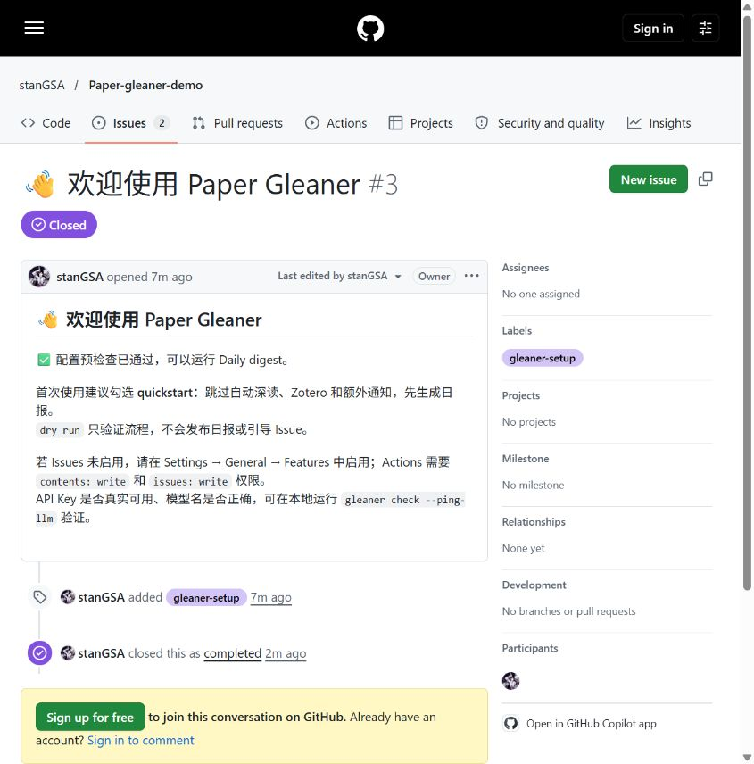

# 首次运行验收记录

## 2026-10-28 · GitHub Actions 冷启动

- 仓库：[stanGSA/Paper-gleaner-demo](https://github.com/stanGSA/Paper-gleaner-demo)。新建的公开演示仓库，使用独立的公开兴趣，不包含个人配置。
- Workflow：[Daily digest #1](https://github.com/stanGSA/Paper-gleaner-demo/actions/runs/40674131995)。结论为 **success**。
- 实际日报：[Issue #2](https://github.com/stanGSA/Paper-gleaner-demo/issues/2)，有 5 条论文评论；`gleaner-data` 已创建并保存结果。
- 平台：GitHub 托管 `ubuntu-latest`，Python 和依赖由锁文件安装；首次运行时嵌入模型缓存未命中，日志有 `Cache not found`，随后完成模型准备。
- 配置：[演示配置](demo/config.yaml)，分类为默认 `cs.CL/cs.LG/cs.AI`，粗筛 **20** 篇、最多推送 **5** 篇；勾选 quickstart，未启用自动深读、Zotero 或额外通知。
- 模型：fast 和 deep 均临时使用接口实际列出的 `deepseek-v4.1-flash-1017`。本地 `.env` 原先填写的 `deepseek-v4.1-flash` 返回 503 / model_not_found，没有修改该文件。GitHub 通过加密 Secrets 注入凭据，模型名通过 variables 设置。

| 事件 | UTC | 北京时间 |
| --- | --- | --- |
| Workflow 创建／开始 | 10:41:37 | 18:41:37 |
| Runner 开始设置 | 10:41:43 | 18:41:43 |
| 安装依赖 | 10:41:47–10:41:48 | 18:41:47–18:41:48 |
| 预检查与日报步骤 | 10:41:48–10:43:56 | 18:41:48–18:43:56 |
| 日报 Issue 创建 | 10:43:46 | 18:43:46 |
| 5 条论文评论全部发布 | 10:43:53 | 18:43:53 |
| Workflow 完成状态更新 | 10:44:02 | 18:44:02 |

从触发到日报正文为 **2 分 9 秒**，到全部论文评论为 **2 分 16 秒**，到 Workflow 完成为 **2 分 25 秒**。抓取 **471** 篇、精排 **20** 篇、推送 **5** 篇，LLM 调用 4 次，无精排失败或降级。机器可读结果见 [first-run-digest.json](demo/first-run-digest.json)。

这次验证了新仓库、空数据分支和未命中嵌入缓存时的实际发布路径，**没有计入用户 Fork、填写兴趣和配置 Secrets 的操作时间**。演示使用 20/5 的候选和输出规模，不能据此声称默认 50/10 配置、所有服务商或任何 Actions 排队条件都能在 10 分钟内完成。仍需不熟悉项目的用户完整照 README 操作，才能验证完整的新用户体验目标。

## 自动引导的真实 API 验证

在演示仓库使用隔离配置运行真实 `gleaner setup --github`。第一轮发现 GitHub 标签筛选列表存在更新延迟，立即重跑生成了重复的 #4。实现已改为扫描未筛选的仓库 Issue、按正文标记识别，并保留最早的 #3、关闭旧版本重复项。

修复后再次连续运行两次缺失配置检查：两次都返回退出码 1，不新增 Issue，只保持[引导 Issue #3](https://github.com/stanGSA/Paper-gleaner-demo/issues/3)打开；再提供有效的公开兴趣和仅用于离线检查的占位 Key，预检查返回 0，并关闭同一条 Issue。该验证没有调用大模型，也没有把占位 Key 当作真实连通性验证。记录见 [onboarding-run.json](demo/onboarding-run.json)。

## 历史论文展示

[Issue #1](https://github.com/stanGSA/Paper-gleaner-demo/issues/1) 使用人工选取的 5 篇历史论文，复用生产排序与渲染代码，调用真实模型生成推荐理由、概览和深读。基础结果用时 **42.39 秒**，含深读共 **95.28 秒**。本地已有依赖和模型缓存；这是演示素材生成时间，不计作冷启动或新用户上手时间。

模型输出、参数与论文列表见 [demo/](demo/README.md)。真实页面截图见 [screenshots/](screenshots/README.md)。人工标注集与 precision@10 评测不在本次任务范围内，Phase 5 仍保留该待办。

